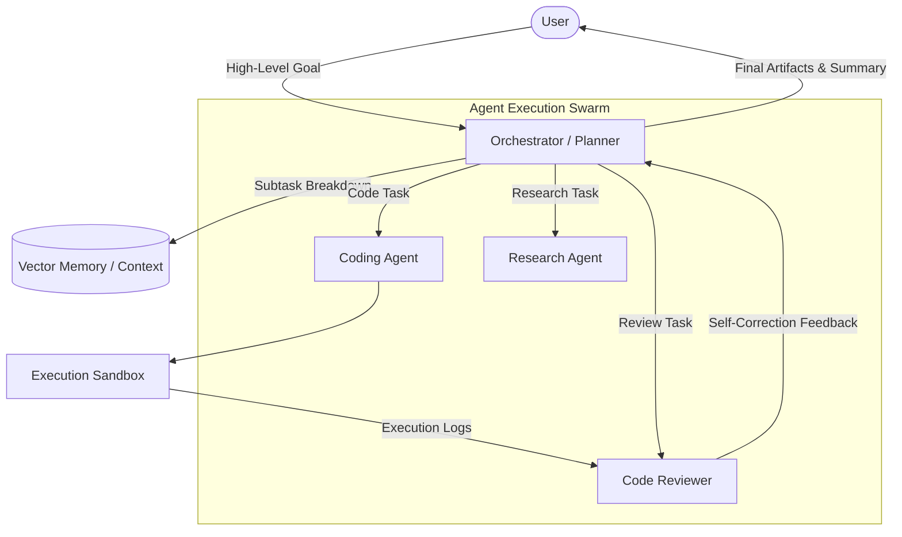
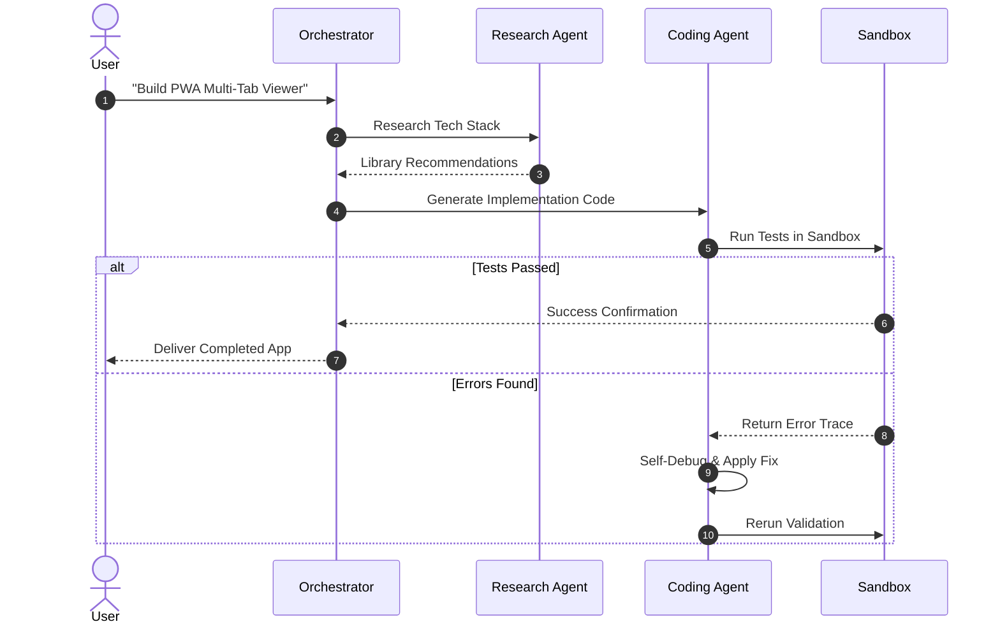

# 🚀 Next-Gen Autonomous AI Agent Platform Architecture Spec

> [!NOTE]
> This document is the technical architecture specification for a next-generation autonomous multi-agent platform leveraging Large Language Models (LLMs). It covers reasoning cycles, tool calling pipelines, and hierarchical memory.

> [!TIP]
> Navigate quickly across sections using the Table of Contents (TOC) on the right. You can also customize your visual reading theme anytime!

---

## 1. System Overview

Autonomous AI agents receive high-level user goals, observe environmental feedback, think and plan iteratively, and dispatch actions within a ReAct loop until task completion.

### 1.1 Core Capabilities
- **Extended ReAct Loop**: Seamless integration of chain-of-thought reasoning and sandboxed execution
- **Hierarchical Memory**: Fast working context coupled with vector embeddings for long-term recall
- **Autonomous Self-Correction**: Automated error recovery and dynamic replanning

#### 1.1.1 Timeout and Safety Boundaries
To avoid runaway inference, each reasoning step is capped at 30 seconds.

##### 1.1.1.a Failsafe Protocol
If three consecutive step failures occur, the agent suspends execution and requests human intervention.

---

## 2. Swarm Architecture (Mermaid Flow)



---

## 3. Interaction Sequence Diagram



---

## 4. Mathematical Modeling of Decision Policy

The action selection probability $P(a_t | s_t)$ is modeled using a softmax policy parameterized by $	heta$:

$$
\pi_\theta(a | s) = \frac{\exp(Q_\theta(s, a) / \tau)}{\sum_{a' \in \mathcal{A}} \exp(Q_\theta(s, a') / \tau)}
$$

Where $\tau > 0$ represents the temperature parameter balancing exploration and exploitation.

---

## 5. Implementation Code Snippet (Python)

```python
import asyncio
from typing import List, Dict, Any

class AutonomousAgent:
    def __init__(self, name: str, system_prompt: str, temperature: float = 0.2):
        self.name = name
        self.system_prompt = system_prompt
        self.temperature = temperature
        self.memory: List[Dict[str, str]] = []

    async def step(self, task: str) -> str:
        print(f"[{self.name}] Thinking: {task}")
        self.memory.append({"role": "user", "content": task})
        await asyncio.sleep(0.3)
        response = f"Successfully completed: {task}"
        self.memory.append({"role": "assistant", "content": response})
        return response

async def main():
    agent = AutonomousAgent("Architect", "System Architect Prompt")
    res = await agent.step("Design multi-tab Markdown reader")
    print("Result:", res)

if __name__ == "__main__":
    asyncio.run(main())
```

---

## 6. Architecture Comparison Matrix

| Criteria | Autonomous Swarm | Single Prompt | Static Pipeline |
| :--- | :--- | :--- | :--- |
| **Adaptability** | ⭐⭐⭐⭐⭐ (Maximum) | ⭐⭐⭐ (Moderate) | ⭐ (Rigid) |
| **Self-Healing** | Yes (Automated Loop) | No (Requires Human) | No (Halts on Exception) |
| **Token Usage** | Medium to High | Low | None |
| **Best Fit** | Complex Engineering | Quick Summaries | Repetitive Batch Jobs |

---

## 7. Rollout Checklist

> [!WARNING]
> Verify sandbox isolation and API token permission boundaries before deploying into production clusters.

- [x] Agent persona and system prompt specification
- [x] Context window compaction benchmarks
- [ ] Sandbox network isolation integration tests
- [ ] Fallback interrupt handler verification
- [ ] Token consumption dashboard
