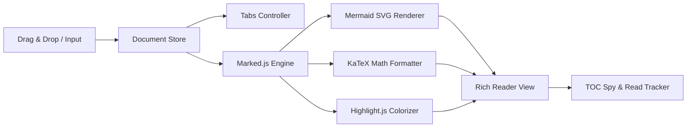

# 🎨 Web Frontend Architecture Spec (PWA & Client Engine)

> [!NOTE]
> Detailed client-side state machine and rendering pipeline specifications for the high-performance AI Markdown Reader.

---

## 1. Component Architecture



---

## 2. Document Data Model Interface (TypeScript)

```typescript
export interface DocumentItem {
  id: string;               // Unique document UUID
  title: string;            // File display name
  rawMarkdown: string;      // Raw Markdown text
  headings: HeadingMeta[];  // Extracted heading hierarchy
  scrollPosition: number;   // Scroll restoration offset
  isAllCollapsed: boolean;  // Heading fold state
}
```

---

## 3. High Performance Guarantees

> [!TIP]
> Maintains 60 FPS smooth scrolling even with documents over 100,000 characters by avoiding full DOM teardowns during tab switches.

1. **Passive Scroll Listeners**: `{ passive: true }` applied to all scroll spies
2. **Instant Code Download**: Client-side Blob generation without server roundtrips
3. **Local Privacy**: Runs 100% on the client machine with zero network leakage
