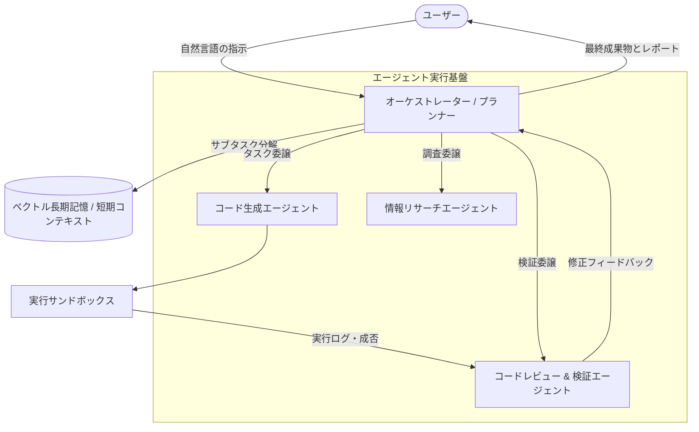
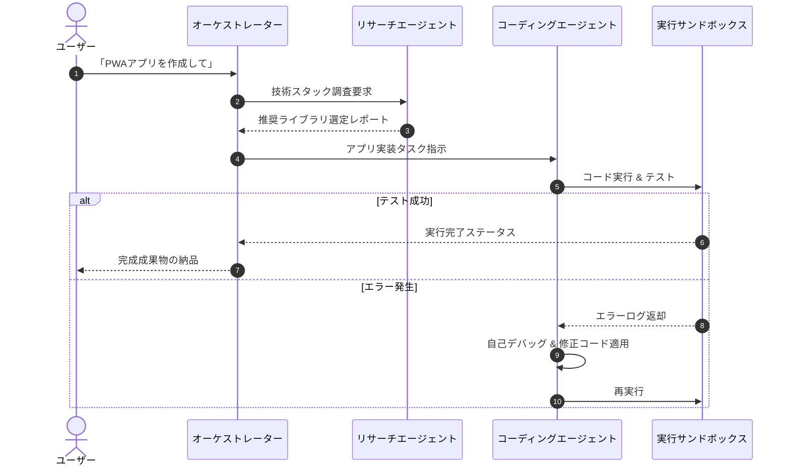

# 🚀 次世代AIエージェント自律基盤 アーキテクチャ設計仕様書

> [!NOTE]
> 本ドキュメントは、LLM（大規模言語モデル）を活用した次世代自律型マルチエージェントシステムの詳細仕様書です。AIの推論サイクル、ツール呼び出しパイプライン、メモリ機構を網羅しています。

> [!TIP]
> 画面右上の目次（TOC）から各セクションへ素早くジャンプできます。また、テーマ切り替えボタンで「サイバーダーク」や「上質ペーパー」など好みのスタイルに変更可能です！

---

## 1. システム全体概要

自律型AIエージェントは、ユーザーの目標（Goal）を受け取り、環境を観察（Observe）、思考・計画（Think / Plan）、行動（Act）をループ処理しながら自律的にタスクを完了します。

### 1.1 主な特徴
- **ReActフレームワーク拡張**: 推論と行動をシームレスに結合
- **永続メモリ階層**: 短期作業メモリとベクトルDBによる長期記憶
- **自律的自己修正**: エラー発生時のフォールバックおよび再計画ループ

#### 1.1.1 思考サイクルのタイムアウト制御 (H4サンプル)
長時間の推論ループを防ぐため、1ステップあたりの思考上限時間を30秒に制限します。

##### 1.1.1.a 例外時のフェイルセーフ (H5サンプル)
連続で3回失敗した場合は自律中断し、人間に介入要求のアラートを通知します。

---

## 2. システムアーキテクチャ (Mermaidフロー)

以下の図は、ユーザー入力からエージェント群が協調動作する処理フローを示しています。



---

## 3. シーケンスダイアグラム

エージェント間メッセージパッシングのタイムラインです。



---

## 4. コアアルゴリズムと推論数式

エージェントの行動選択確率 $P(a_t | s_t)$ は、ソフトマックス方策関数により以下のようにモデル化されます。

$$
\pi_\theta(a | s) = \frac{\exp(Q_\theta(s, a) / \tau)}{\sum_{a' \in \mathcal{A}} \exp(Q_\theta(s, a') / \tau)}
$$

ここで、$\tau > 0$ は温度パラメータ（Temperature）であり、探索と活用のトレードオフを制御します。

また、長期割引累積報酬 $R_t$ の期待値最適化はベルマン方程式に従います。

$$
Q^*(s, a) = \mathbb{E}\left[ r + \gamma \max_{a'} Q^*(s', a') \;\middle|\; s, a \right]
$$

---

## 5. 実装サンプルコード

### 5.1 Python: エージェントループ基盤

```python
import asyncio
from typing import List, Dict, Any

class AutonomousAgent:
    def __init__(self, name: str, system_prompt: str, temperature: float = 0.2):
        self.name = name
        self.system_prompt = system_prompt
        self.temperature = temperature
        self.memory: List[Dict[str, str]] = []

    async def step(self, user_instruction: str) -> str:
        """思考(Think)と行動(Act)の1イテレーションを実行"""
        print(f"[{self.name}] 思考中: {user_instruction}")
        self.memory.append({"role": "user", "content": user_instruction})
        
        # LLM呼び出しシミュレーション
        await asyncio.sleep(0.5)
        response = f"指示「{user_instruction}」に対するタスクを実行完了しました。"
        self.memory.append({"role": "assistant", "content": response})
        return response

# 実行
async def main():
    agent = AutonomousAgent("Architect", "You are an expert system architect.")
    result = await agent.step("PWAの設計を開始してください")
    print("Result:", result)

if __name__ == "__main__":
    asyncio.run(main())
```

### 5.2 TypeScript: イベントハンドラと型定義

```typescript
export interface AgentMessage {
  id: string;
  sender: 'user' | 'agent' | 'system';
  content: string;
  timestamp: number;
  metadata?: {
    tokensUsed: number;
    latencyMs: number;
  };
}

export const dispatchTask = async (task: string): Promise<AgentMessage> => {
  const start = performance.now();
  console.log(`Processing task: ${task}`);
  
  return {
    id: crypto.randomUUID(),
    sender: 'agent',
    content: `Processed: ${task}`,
    timestamp: Date.now(),
    metadata: {
      tokensUsed: 1420,
      latencyMs: Math.round(performance.now() - start),
    }
  };
};
```

---

## 6. 技術スタック比較表

| 項目 | 方式A: 自律エージェント | 方式B: シングルプロンプト | 方式C: 静的スクリプト |
| :--- | :--- | :--- | :--- |
| **柔軟性** | ⭐⭐⭐⭐⭐ (極めて高い) | ⭐⭐⭐ (普通) | ⭐ (変更に弱い) |
| **自己修復能力** | あり (エラー自己解決) | なし (人間が介在) | なし (例外停止) |
| **トークン消費** | 中〜大 | 小 | なし |
| **推奨ユースケース** | 複雑な開発・調査・自動化 | 定型要約・単発Q&A | ルーチンバッチ処理 |

---

## 7. 導入ステップ & チェックリスト

> [!WARNING]
> 本番稼働前に、APIキーのアクセス権限およびサンドボックス環境のネットワーク隔離が設定されていることを必ず確認してください。

- [x] 要件定義とエージェントペルソナ策定
- [x] プロンプトテンプレートの整備
- [ ] サンドボックスコンテナ環境の隔離テスト
- [ ] 異常終了時のフォールバック処理の実装
- [ ] トークン利用量監視ダッシュボードの構築

---

## 8. まとめと展望

自律型AIエージェントの登場により、従来の「指示して待つ」スタイルから、「目標を与えて伴走する」パラダイムへと進化しています。
Markdownを活用した明快なドキュメンテーションは、人間とAIが共通言語として協調するための極めて重要な架け橋となります。
