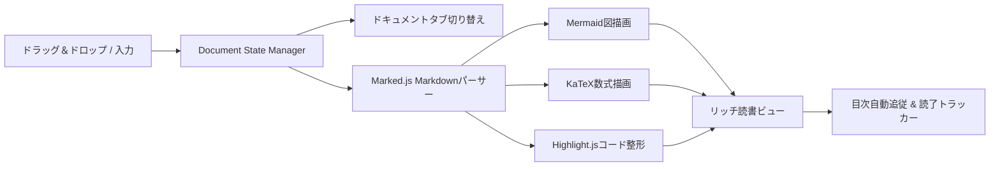

# 🎨 Webフロントエンド実装設計書 (PWA & Client Architecture)

> [!NOTE]
> 本書は、AI Markdown Readerのクライアントサイド・アーキテクチャおよび状態管理仕様をまとめたフロントエンド設計書です。

---

## 1. コンポーネント設計概要

軽量かつ高速に動作するSPA（シングルページアプリケーション）構成を採用しています。



---

## 2. ドキュメント状態管理インターフェース (TypeScript)

複数ファイルをシームレスに切り替えるためのデータモデル定義です。

```typescript
export interface DocumentItem {
  id: string;               // 一意のドキュメントUUID
  title: string;            // ファイル名 (拡張子付き)
  content: string;          // 生のMarkdownテキスト
  headings: HeadingMeta[];  // 見出し階層データ
  scrollPosition: number;   // タブ切り替え時のスクロール復元位置
  readProgress: number;     // 読破率 (0 - 100%)
  createdAt: number;        // 読み込み日時
}

export interface HeadingMeta {
  id: string;
  text: string;
  level: number;
  isRead: boolean;
}
```

---

## 3. パフォーマンス最適化の指針

> [!TIP]
> 10万文字を超える長大なMarkdownでも、DOMの再構築を最小限に抑えることで60fpsの快適なスクロールを維持します。

1. **Passive Event Listener**: スクロールスパイには `{ passive: true }` を適用
2. **IntersectionObserver**: 画面外の要素のレンダリング負荷を抑制
3. **Web Worker対応**: 必要に応じたバックグラウンドパースの分離

---

## 4. UI状態マトリクス

| 状態名 | タブ表示 | 目次同期 | 読破率トラッキング |
| :--- | :--- | :--- | :--- |
| **単一ドキュメント** | 単一アクティブタブ | 単一TOC | リアルタイム更新 |
| **複数ドキュメント** | 水平スクロールタブ群 | アクティブTOCに切替 | ドキュメント毎に個別保持 |
| **Zenモード** | 非表示 (全画面) | 非表示 | バックグラウンド計測 |

---

## 5. 今後の拡張ロードマップ

- [x] 複数Markdownタブの同時展開と瞬時切り替え
- [x] ドキュメントごとのスクロール位置保持
- [ ] 2画面分割（Split View）による横並びドキュメント比較
- [ ] 複数ファイルの一括HTML結合エクスポート
